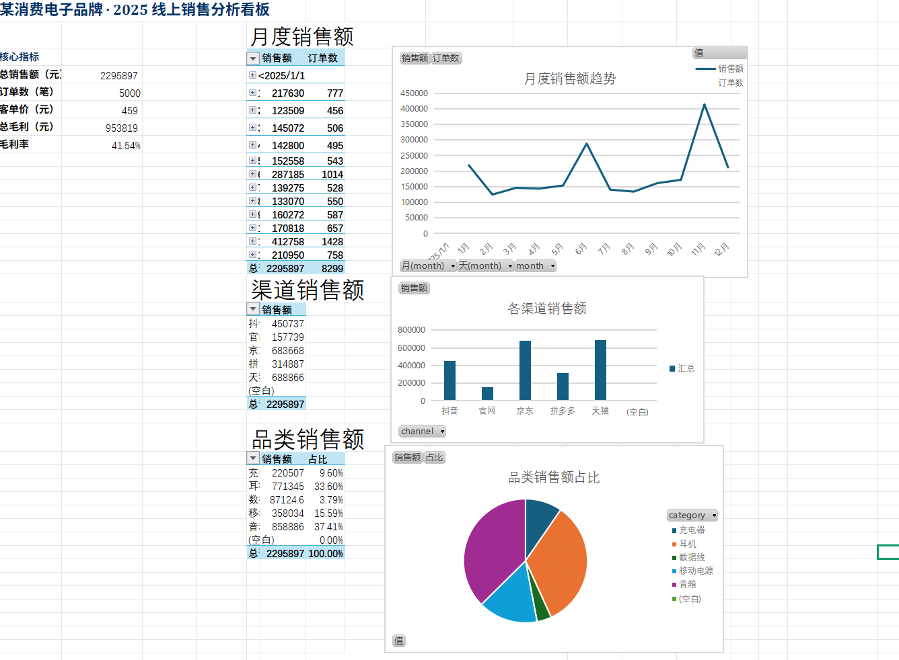
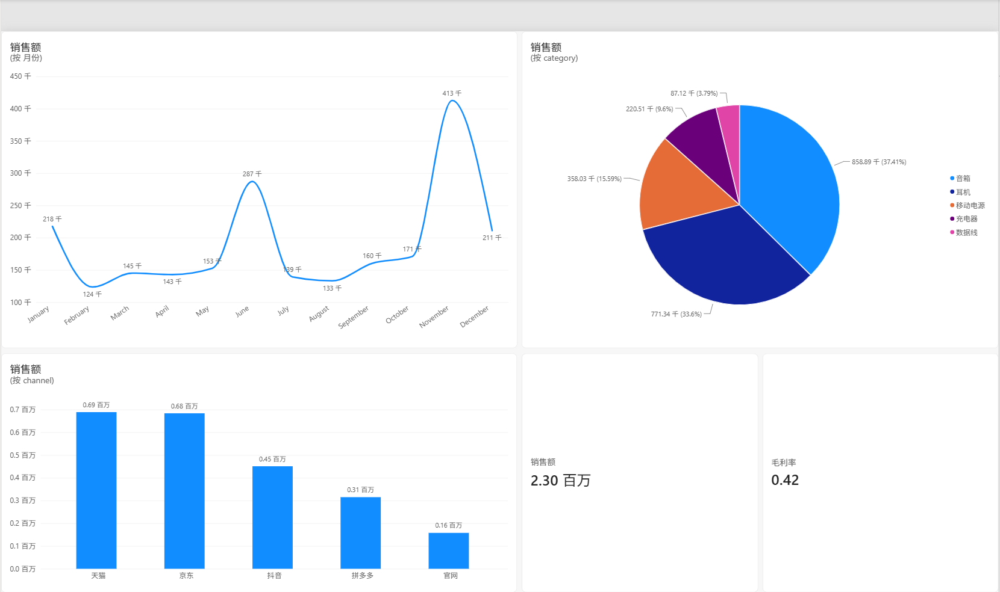

# 消费电子线上销售分析（Excel + MySQL + Power BI）

> 安徽大学生物专业 2028 届｜求职方向：供应链 / 需求计划

用一份 **5,000 笔订单**的模拟数据集，走通「数据 → 分析 → 结论 → 建议」的完整链路，并用三种工具分别呈现。

> ⚠️ **数据说明**：本仓库数据由 Python 脚本（`Faker` 式随机生成 + 季节权重）模拟产生，**不含任何真实企业数据**。目的是完整复现分析流程，而非展示真实业绩。

---

## 一、核心结论（全部可复算）

| # | 结论 | 数字 |
|---|---|---|
| 1 | 销售高度依赖大促月 | 6 月（287,185 元）+ 11 月（412,758 元）= 全年 **30.5%** |
| 2 | 折扣最高的渠道贡献最低 | 拼多多平均折扣 **23.5%**（全渠道最高），仅贡献 **13.7%** 销售额 |
| 3 | 官网是利润渠道 | 官网折扣仅 **2.4%**，占销售额 6.9% 但毛利率最优 |
| 4 | 品类高度集中 | 音箱 37.4% + 耳机 33.6% = **71.0%**；数据线仅 3.8%，属引流型 |
| 5 | 存货周转正常，资金集中在头部 SKU | 全店 **7.92 次/年（46.1 天）**；资金占用最高 P002（2.49 万元），最慢 P011（51.1 天） |

**全店指标**：销售额 2,295,897 元｜订单 5,000 笔｜客单价 459 元｜毛利率 41.5%

---

## 二、看板截图

**Excel 看板**（3 张透视表 + 3 张图表 + SUMIFS 驱动的指标卡）



**Power BI 仪表板**（商品-订单-客户关系模型 + DAX 度量值 + 三视图）



---

## 三、三种工具做了什么

| 工具 | 用途 | 产出 |
|---|---|---|
| **Excel** | 业务方能改的模板 | 3 张透视表（月度/渠道/品类）+ 3 张图表 + SUMIFS 驱动的看板 |
| **MySQL** | 取数与对数底稿 | 建表 + `LOAD DATA` 导入 + 20 道分析题（窗口函数、CTE、库存周转） |
| **Power BI** | 汇报用仪表板 | 商品-订单-客户关系模型 + 4 个 DAX 度量值 + 3 张可视化 |

**交叉验证**：`SUM(amount)` 在 SQL、`SUMIFS` 在 Excel、`SUM()` 在 Power BI 三处结果均为 **2,295,897**，数据链路一致。

---

## 四、目录结构

```
.
├── data/
│   ├── orders.csv       # 5,000 笔订单（15 字段）
│   ├── products.csv     # 20 个 SKU
│   ├── customers.csv    # 800 个客户
│   └── inventory.csv    # 月度库存/出库（供应链分析用）
├── sql/
│   ├── MySQL_20题.sql   # 建表 + 导入 + 20 道分析题（含答案与考点）
│   └── MYSQL练习题.txt   # 个人练习记录
├── excel/
│   └── 作品，excel看板.xlsx   # 含 订单明细/看板/业务结论/inventory/库存周转
├── powerbi/
│   ├── power BI作品.pbix
│   └── POWER BI作品.pdf       # 导出的仪表板（免装 Power BI 也能看）
└── screenshots/
    ├── 01-excel-dashboard.png
    └── 02-powerbi-dashboard.png
```

---

## 五、关键 SQL（窗口函数示例）

```sql
-- 月度销售额 + 环比增长率
SELECT month,
       ROUND(SUM(amount), 0) AS 销售额,
       ROUND((SUM(amount) - LAG(SUM(amount)) OVER (ORDER BY month))
             / LAG(SUM(amount)) OVER (ORDER BY month) * 100, 1) AS 环比百分比
FROM orders
GROUP BY month
ORDER BY month;

-- 库存周转（**金额口径**：营业成本 ÷ 平均存货金额，天数用 365）
-- 数量口径（出库量÷平均库存量）只适合同款追踪，跨品类不可比
SELECT t.product_id,
       ROUND(t.avg_stock_val, 0)                  AS 平均存货金额,
       ROUND(t.cogs, 0)                           AS 年度营业成本,
       ROUND(t.cogs / t.avg_stock_val, 2)         AS 周转次数,
       ROUND(365 / (t.cogs / t.avg_stock_val), 1) AS 周转天数
FROM (
    SELECT i.product_id,
           AVG(i.stock_qty * p.cost) AS avg_stock_val,
           (SELECT SUM(o.cost) FROM orders o
             WHERE o.product_id = i.product_id) AS cogs
    FROM inventory i
    JOIN products p ON i.product_id = p.product_id
    GROUP BY i.product_id
) t
ORDER BY 周转天数 DESC;
```

---

## 六、局限与改进方向（诚实说明）

1. **数据是模拟的**：不含真实的价格弹性、退货率、缺货损失，因此结论只能证明方法，不能证明业务判断。
2. **只有描述性统计**：未做预测建模。下一步计划用季节性系数 + 移动平均预测下季度需求，并用 MAPE 验收。
3. **折扣建议未量化**：目前是「建议控制在 25% 以内」，应补敏感性分析（假设弹性 2%/4% 两档，看结论是否反转）。
4. **库存数据较粗糙**：只有月末快照，真实场景需要日粒度与在途库存。

---

## 七、技能清单

`Excel`（透视表 / SUMIFS / Power Query）· `MySQL`（JOIN / 窗口函数 / CTE / 条件聚合）· `Power BI`（数据建模 / DAX 度量值 / 可视化）· `Python`（pandas 数据生成与校验）

---

*个人练习项目｜2026.11*
